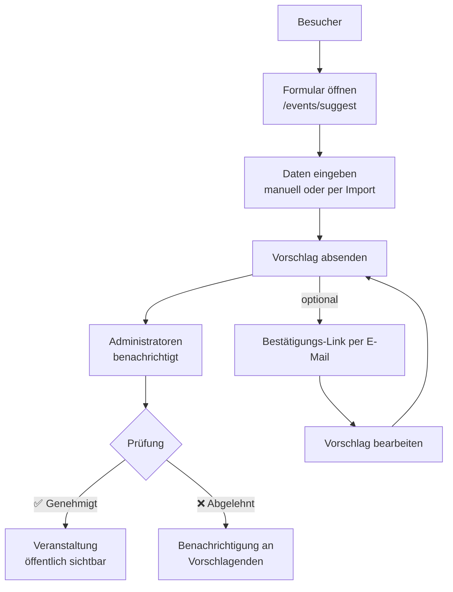

# Veranstaltungen & Feeds vorschlagen

Auch ohne Benutzerkonto kannst du auf dansal etwas beitragen: eine fehlende **Veranstaltung** vorschlagen oder einen ganzen **Kalender-Feed** anmelden. Beides wird von Administratoren geprüft und veröffentlicht.

## ➕ Veranstaltung vorschlagen

Auch ohne Benutzerkonto kannst du eine fehlende Veranstaltung vorschlagen, damit sie auf dansal erscheint.

**So funktioniert's:**
1. Über „Veranstaltung vorschlagen“ in der Navigation die Seite `/events/suggest` öffnen
2. Die Angaben für den sechsstufigen Formular-Assistenten eintragen – von Hand oder deutlich schneller per Kalenderimport, der die Felder automatisch füllt (siehe „📅 Kalenderimport als Abkürzung“)
3. Vorschlag absenden – die Administratoren werden direkt benachrichtigt und der Vorschlag ist sofort für sie zur Prüfung sichtbar, unabhängig von einer E-Mail-Bestätigung
4. Ist E-Mail-Versand eingerichtet, erhältst du zusätzlich einen Link per E-Mail, über den du den Vorschlag später jederzeit selbst einsehen oder bearbeiten kannst – ein Klick darauf ist aber keine Voraussetzung dafür, dass der Vorschlag bei den Administratoren ankommt
5. Ein Administrator prüft den Vorschlag und veröffentlicht ihn – bis dahin ist die Veranstaltung **nicht öffentlich sichtbar**

**📝 Die Formularfelder (Schritt für Schritt)**
- **Was:** Titel sowie Art/Tags (Ball, Workshop, Festival, Open-Air, Session, Konzert …) und bei Workshops das Niveau (Anfänger/Mittel/Fortgeschritten); dazu Tänze sowie Musikerinnen/Musiker und Kursleiterinnen/Kursleiter – Namen werden beim Tippen aus der Suche vorgeschlagen Ist kein Musiker bekannt, kannst du „Keine Live-Musik“ ankreuzen (Aufnahme, DJ oder Übungsabend). Musiker und dieses Kästchen schließen sich gegenseitig aus.
- **Wann:** Datum, Start- und Endzeit sowie der Eintrittspreis (frei, Spende, fester Betrag oder gestaffelte Preistabelle). Das **Datum** lässt sich wahlweise direkt ins Textfeld eintippen (z. B. `DD.MM.YYYY`) **oder** per Klick auf den Kalender-Button (Datepicker) auswählen – beides funktioniert
- **Wo:** Veranstaltungsort. Ein Suchfeld schlägt bereits bekannte Orte und OpenStreetMap-Orte vor; ist der Ort noch nicht erfasst, werden Name, Straße, PLZ, Ort und Land eingegeben
- **Beschreibung:** Beschreibungstext, Link zur Original-Veranstaltungsseite sowie Speisen/Getränke
- **Ablaufplan:** optional ein Zeitplan mit Programmpunkten (Beginn/Ende, Titel, Raum, Art, Beschreibung)
- **Kontakt:** Name und E-Mail-Adresse; ein Bild kann nach der Verifizierung über den Verwaltungslink nachträglich hochgeladen werden

**📅 Kalenderimport als Abkürzung**
- Statt alles von Hand einzutippen: im Assistenten auf den Reiter **Import** wechseln und eine `.ics`-Datei aus deinem Kalenderprogramm (z. B. vom Veranstaltungsort oder -verein) oder eine passende `.json`-Datei per Drag & Drop hochladen – oder eine Kalender-URL einfügen, z. B. `https://beispiel.de/kalender.ics`
- Die Datei wird eingelesen und in eine Vorschau übernommen: Enthält sie mehrere Termine, wählst du den gewünschten in der Auswahlliste aus („Verwenden“). Titel, Datum/Uhrzeit, Ort und Beschreibung des Termins füllen damit automatisch die passenden Felder des Assistenten
- Die übernommenen Werte sind eine Vorlage: Jeder Schritt kann im Assistenten weiter geprüft und von Hand korrigiert werden, bevor du absendest

**Hinweise:**
- Die Funktion ist nur verfügbar, wenn die Instanz E-Mail- oder Telegram-Benachrichtigungen konfiguriert hat – ist beides nicht eingerichtet, ist die Seite nicht erreichbar
- Zum Schutz vor Spam gibt es ein Rate-Limit pro IP-Adresse sowie automatische Bot-Erkennung
- Eine angegebene E-Mail-Adresse wird nur zur Verifizierung verwendet (siehe [Datenschutz](Besucher-Datenschutz))

## 🔄 Feed vorschlagen

Kennst du einen Verein oder eine Location mit eigenem Veranstaltungskalender (iCal- oder JSON-Feed), der noch nicht auf dansal erscheint? Auch das lässt sich ganz ohne Benutzerkonto vorschlagen – anders als beim einzelnen Veranstaltungsvorschlag oben wird hier ein **ganzer, dauerhaft automatisch aktualisierter Feed** angemeldet.

**So funktioniert's:**
1. Über „Feed vorschlagen“ die Seite `/feeds/suggest` öffnen
2. E-Mail-Adresse angeben und entweder eine bestehende Organisation auswählen oder eine neue vorschlagen
3. Feed-URL eingeben – eine Vorschau prüft, ob sich der Feed einlesen lässt und zeigt die enthaltenen Veranstaltungen
4. Enthaltene Ortsangaben einzeln einem bestehenden Ort zuordnen oder mit Adresse/Ort für einen neuen Ort ergänzen
5. Vorschlag absenden – auch hier landet er sofort bei den Administratoren (bzw. bei bereits aktiven Mitgliedern der gewählten Organisation) zur Prüfung
6. Bei Genehmigung wird die Organisation/der Ort bei Bedarf angelegt und die Veranstaltungen sofort erstmalig abgerufen

Auf der Bestätigungsseite und per E-Mail wird direkt ein Link angeboten, um ein Konto einzurichten und die Organisation bzw. den Feed künftig selbst zu verwalten.

**Nur eine einzelne Veranstaltungsseite statt eines ganzen Feeds?** Beim Feld „Typ“ lässt sich statt der automatischen Erkennung auch „Event-Seite (JSON-LD)“ auswählen. Damit lässt sich die URL einer einzelnen Veranstaltungsseite vorschlagen, die ihre Angaben in strukturierten Daten (schema.org, wie sie z. B. WordPress-Eventkalender-Plugins oder viele Ticketing-Anbieter automatisch einbetten) veröffentlicht – auch ohne eigenen iCal- oder JSON-Feed. Da es sich um eine einzelne Seite statt eines dauerhaften Feeds handelt, wird sie nur einmalig abgerufen, nicht laufend aktualisiert.

**Hinweise:** wie beim Veranstaltungsvorschlag ist die Funktion nur verfügbar, wenn die Instanz E-Mail- oder Telegram-Benachrichtigungen konfiguriert hat, und ebenso mehrschichtig gegen Missbrauch abgesichert (Rate-Limit, Bot-Erkennung).
